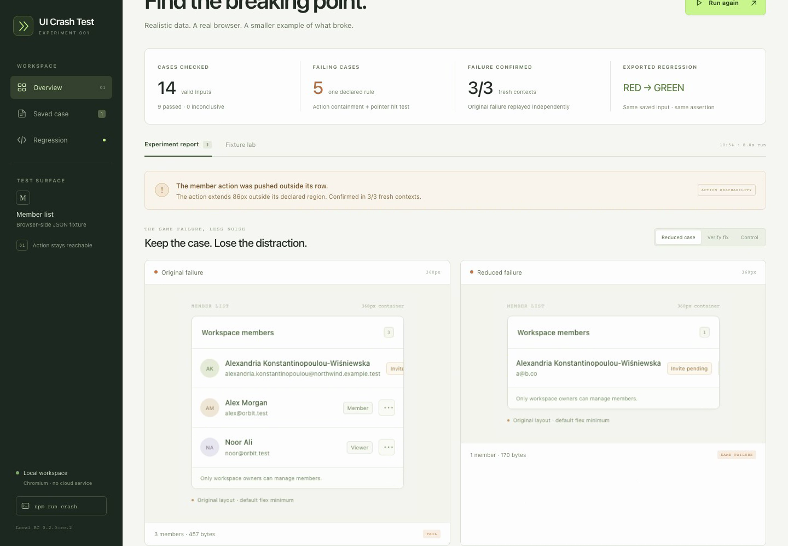

# UI Crash Test

**Find a smaller valid input that breaks a UI rule. Keep it as a verified Playwright regression.**

Supply data through an application's real API response or native form, prove it rendered, check a declared rule, confirm a failure three times, then reduce the input without leaving its valid domain. Keep the exact case, source hashes, screenshots and an executed regression.

[](https://github.com/boranfurkan/ui-crash-test/releases/download/v0.3.0-rc.1/ui-crash-test-demo.webm)

[Watch the real demo](https://github.com/boranfurkan/ui-crash-test/releases/download/v0.3.0-rc.1/ui-crash-test-demo.webm) · [Text-fit case study](docs/text-fit.md) · [Comparison](docs/research/comparison.md) · [SDK guide](docs/sdk.md)

## Install

Node 22.12+ and Chromium are required. npm publication is pending account verification. Install the verified release tarball directly for now:

```sh
npm install --save-dev https://github.com/boranfurkan/ui-crash-test/releases/download/v0.3.0-rc.1/ui-crash-test-0.3.0-rc.1.tgz @playwright/test@1.64.1
npx playwright install chromium
npx ui-crash-test init
# Adapt ui-crash.config.ts to your app's actual data, selectors and source files.
npx ui-crash-test doctor --url http://localhost:3000
npx ui-crash-test run --url http://localhost:3000
```

Keep the app running separately. `init` preserves existing files. `doctor` checks the adapter, source files and real normal-data control before a campaign. It writes no campaign artifacts. Config files are trusted executable TypeScript/JavaScript.

Campaign exit codes: **0** no failure found, **1** confirmed failure, **2** inconclusive/setup error. A ready diagnosis is a setup check; it does not measure stress cases. For a local unpublished candidate, install the supplied SDK tarball instead of `ui-crash-test@next`.

[SDK.md](docs/sdk.md) includes a complete native-form adapter, API-response setup, library use, output paths and replay instructions. Declare a normal baseline, valid cases, rendered-input proofs, permitted setup and domain-preserving reduction candidates. This configuration is explicit; the tool does not infer contracts from arbitrary pages.

## Two explicit rules

| Rule | Example requirement | Measurement |
| --- | --- | --- |
| `action` (default) | Save remains reachable inside its form. | Element containment and a center-point pointer hit, with declared scrolling/hover. |
| `text-fit` | The required profile name fits across its header. | Native text-fragment geometry against the region and supported horizontal overflow clips. Wrapping is allowed. |

```ts
rule: {
  kind: 'text-fit', id: 'required-name-fits',
  target: 'main header h1', boundary: 'main header:has(h1)',
}
```

The text rule is opt-in where full text is required. An intentionally ellipsized label can have a reachable action and fail a strict full-text contract. [TEXT-FIT.md](docs/text-fit.md) explains unsupported layouts and limits.

## A real reduced text failure

In the unchanged user-owned Holo Grails app, the Save action passes all 14 supplied cases. Applying a separate full-name text-fit policy catches the saved heading's clipping at 320px. The normal control passes; the failure confirms in **3/3 fresh contexts**, reduces **262 → 83 UTF-8 JSON bytes** in six probes and reproduces through its exported regression after independent installation.

[Actual campaign](docs/evidence/text-fit/report.html) · [Reduced input](docs/evidence/text-fit/case.json) · [Detached replay check](docs/evidence/text-fit/detached-verification.json)

A browser-only wrapping candidate passes the same copied rule and saved input. The original app is unchanged. This is an assisted integration and a declared visibility policy, not an independent user study or an automatic application repair.

## Try the visual demo from source

```sh
gh repo clone boranfurkan/ui-crash-test
cd ui-crash-test
npm ci
npx playwright install chromium
npm run dev
```

Open http://127.0.0.1:4173 and run a real campaign. The member-list reference deliberately includes a flex defect and its fixed variant. The dashboard also checks pinned shopping-app components, actual Radix dialog/table components and the unchanged complete Vue TodoMVC distribution. [Source adapter guide](docs/scenarios.md).

The [cart finding](docs/case-studies/cart.md) concerns pinned 2021 source in a local harness; it is not a claim against the current deployed site. The maintained Vue example passes every supplied case. The development server provides the campaign API; static `dist/` alone cannot run campaigns.

## What stays with a failure

HTML/JSON reports, actual inputs and measurements, browser/runtime information, declared source hashes, screenshots and a replay ZIP. The runner executes its exported test and checks the measured attachment against the saved failure signature. No-failure runs create no pretend failing regression.

Extract the ZIP, follow its README and keep the configured app available. `UI_CRASH_BASE_URL` overrides the app URL. The bundle contains the saved data, recipe and actual rule/replay implementation, not the app.

## Evidence and limits

- [Matched action comparison](docs/research/comparison.md): 44 authored cases / 132 observations. Independent native Playwright catches the same demonstrated application defects. Broad renderlint findings are retained separately. The candidate value is valid-input reduction and saved replay.
- [Verification](docs/validation/verification.md): local checks and actual Linux Node 22/24 CI, including isolated installed-package and exported replay checks. [Action controls](docs/controls.md) preserve known center-point blind spots.
- Reduction searches declared candidates within a budget and preserves validity plus rule/target/boundary/failure kind. It does not guarantee a global minimum.
- Text fit measures horizontal geometry; it does not prove vertical visibility, viewport presence, occlusion, glyph-pixel paint or accessibility. Unsupported complex layouts return inconclusive.
- Chromium only. Fonts/platforms can affect geometry. Only declared app sources are guarded against drift. Use synthetic fixtures for shareable evidence.
- The [self-guided trial](docs/validation/trial.md) remains prepared for a real participant. Independent adoption, easier setup, human debugging-speed gains and popularity are unestablished.

## Contribute and verify

```sh
npm run build
npm test
npm run test:browser
npm run pack:sdk
npm run verify:sdk
```

The source workspace is private in its npm manifest; `pack:sdk` produces the separate publishable library/CLI package. [Contributing](CONTRIBUTING.md) · [Changelog](CHANGELOG.md). MIT licensed; vendored fixture licenses/provenance remain with their source.

[Repository layout](docs/architecture.md) · [Evidence policy](docs/evidence/README.md) · [Next validation](docs/roadmap.md).
