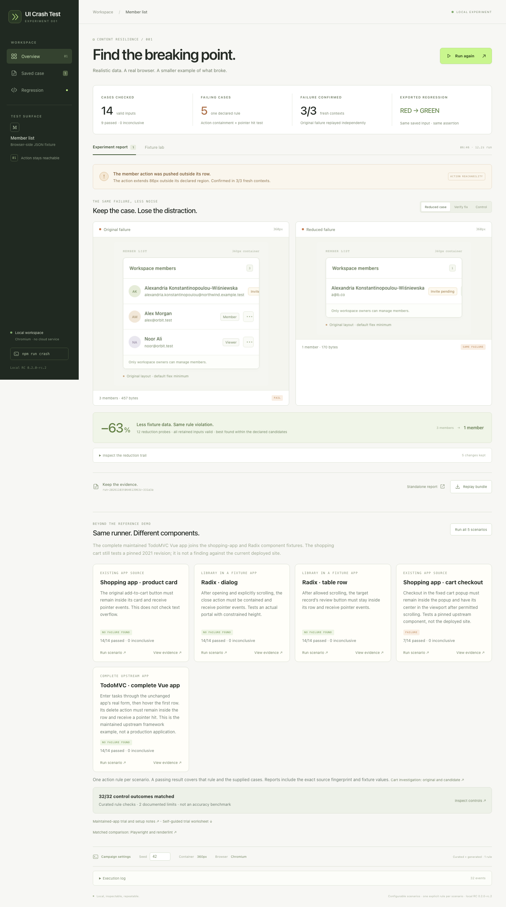

# UI Crash Test

**Find a smaller valid input that breaks a UI action rule. Keep it as a Playwright regression.**

A Node/TypeScript library and CLI for an explicitly configured app. Supply valid inputs through a real API response or native form, prove the values rendered, check a declared action, reduce a confirmed failure and execute the saved regression. The repository includes a visual dashboard and reproducible fixtures.

**Local release candidate: 0.2.0-rc.2.** Not published to npm. The supplied SDK tarball is separate from this source checkout; both package manifests remain private. See [the review handoff](REVIEW.md) and [SDK guide](SDK.md).



## Try the demonstration

Requires Node 22.12+ and npm. Local verification covers Node 22.12.0 and 24.21.0 on macOS with Chromium 156.0.8078.4.

```sh
npm ci
npx playwright install chromium
npm run dev
```

Open http://127.0.0.1:4173 and click **Run crash test**. The member-list example deliberately includes a layout defect and its fixed variant. The run verifies normal data, tests 14 valid cases, confirms the same failure three times, reduces it, saves evidence and executes the exported test against both layouts. It does not repair app source automatically.

The dashboard also runs five external scenarios: an unchanged shopping-app card and cart, actual Radix dialog/table components, and the complete unchanged TodoMVC Vue distribution. The [cart case study](CASE-STUDY.md) concerns pinned 2021 source in a local harness, not the current deployed site. The [maintained Vue app](MAINTAINED-APP.md) passes all 14 supplied cases.

```sh
npm run crash                         # reference red-to-green campaign; starts its own server
npm run scenarios                     # five external scenarios; starts its own server
npm run scenarios -- --scenario member-list
```

The Vite development server provides the campaign API. Static `dist/` alone cannot run campaigns.

## Use it with your app

Build the SDK tarball from this checkout, or use the one supplied with the handoff:

```sh
npm run pack:sdk
# Writes ../ui-crash-test-0.2.0-rc.2.tgz
```

In your app's directory:

```sh
npm install --save-dev /absolute/path/ui-crash-test-0.2.0-rc.2.tgz @playwright/test@1.64.1
npx playwright install chromium
npx ui-crash-test init
# Adapt ui-crash.config.ts to your actual input contract, paths and selectors.
npx ui-crash-test doctor --url http://localhost:3000
npx ui-crash-test run --url http://localhost:3000
```

Keep the target app running separately. `init` preserves existing files. `doctor` validates the config/sources and checks the real normal-data control before a campaign. It exits 0 when ready or 2 when blocked, with a failed stage and actual reason; it does not measure stress cases or write campaign artifacts. Exit codes are 0 for no failure found, 1 for confirmed failure and 2 for inconclusive/setup error. Configs are trusted executable TypeScript/JavaScript.

[SDK.md](SDK.md) includes a complete native-form example, the API-response boundary and library API. [SCENARIOS.md](SCENARIOS.md) describes the repository fixtures and their provenance. You declare a baseline, valid cases, reduction candidates, input boundary, rendered-input proofs, permitted setup, action selector and containing region. The tool does not infer these from arbitrary pages.

## What a run keeps

Every completed run retains HTML/JSON reports, actual inputs, measurements, browser/runtime information and declared source hashes. Confirmed failures additionally retain screenshots, the reduced input and a replay ZIP containing the actual rule/replay implementation and a Playwright test. The runner executes that exported test and checks its attached finding against the saved failure signature. No-failure runs do not export a pretend failing test.

A replay bundle requires the configured app to remain available. Extract it, follow its README, install its dependencies and run `npm test`. It should fail for the saved defect and pass after repair. `UI_CRASH_BASE_URL` overrides the app URL. It does not contain a standalone copy of your application.

## Evidence and comparison

The [matched comparison](COMPARISON.md) retains **44 cases and 132 observations** against independent ordinary Playwright assertions and a pinned renderlint layout profile. Our rule and native checks agree on all **12 application states**, including four failing states from two known defects. Four synthetic control disagreements expose different scrolling, opacity and inert-state policies. Renderlint performs a broader layout audit; its findings are retained without converting issue counts into an action-failure score.

The member reference reduces **457 → 170 bytes**; the external cart reduces **401 → 156 bytes** while preserving the failure. Byte reduction is demonstrated; faster human debugging is unmeasured. Ordinary Playwright detects the same application failures. The candidate value is validated input reduction and retained replay.

## Checks

```sh
npm test                    # 24 unit tests
npm run test:browser         # 52 Chromium tests
npm run build               # SDK, TypeScript and frontend
npm run compare             # fixed comparison corpus and raw reports
npm run pack:sdk             # private local tarball, no publication
npm run verify:sdk           # isolated consumer: CLI, API, real pass/fail and exported replay
```

[VERIFICATION.md](VERIFICATION.md) records local results. GitHub Actions is configured for Linux/Node 22.12 and 24; it has not been executed remotely. Upstream Sass and client-directive build warnings remain.

## Boundaries

- One declared action: it fits its region within 1px and receives a pointer hit at its center. Scrolling and hover are explicit. Missing, ambiguous, hidden or disabled targets are inconclusive.
- Off-screen centers are inconclusive unless `requireViewportCenter` explicitly requires viewport reachability. Center checks can miss edge clipping and corner-only overlays; [32 authored controls](CONTROLS.md) retain these limits.
- Reduction searches declared candidates within a budget, preserving valid inputs and the rule/target/boundary/failure-kind signature. It does not guarantee a global minimum.
- Chromium only; platform/font differences can affect geometry. This is not an accessibility or overall-usability audit.
- Only declared app sources are fingerprinted. Add the actual relevant files to each adapter. Saved artifacts contain supplied values; use synthetic fixtures when sharing them.

The [self-guided trial](TRIAL.md) is prepared for later, as requested. No independent participant, adoption, popularity, debugging-speed or superiority claim has been established. [NEXT.md](NEXT.md) separates optional future validation from this completed release candidate.

MIT licensed. The design draws on established work including [fast-check](https://fast-check.dev/), [Playwright](https://playwright.dev/), [ReDeCheck](https://github.com/redecheck/redecheck), [Galen](https://github.com/galenframework/galen) and [break-ui](https://github.com/emilkowalski/skills/tree/main/skills/break-ui). The measurement/reduction engine was written for this project; vendored fixture licenses and provenance remain with their source.
