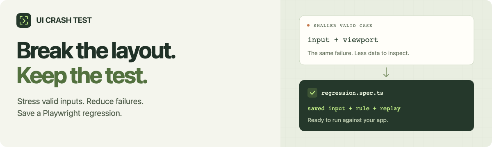

# UI Crash Test

**Find the input that breaks your layout. Keep the test that catches it.**



[](https://www.npmjs.com/package/ui-crash-test) [](https://nodejs.org/) [](https://github.com/boranfurkan/ui-crash-test/blob/main/LICENSE)

Stress your local app with valid data, confirm a layout failure, and shrink it into a reproducible Playwright test.

[Documentation](https://github.com/boranfurkan/ui-crash-test/blob/main/docs/README.md) · [Demo](https://github.com/boranfurkan/ui-crash-test/releases/download/v0.3.0-rc.1/ui-crash-test-demo.webm) · [GitHub](https://github.com/boranfurkan/ui-crash-test) · [Report a bug](https://github.com/boranfurkan/ui-crash-test/issues/new/choose)

## Get started

Requires **Node.js 22.12+** and Chromium. Use the `next` tag for this early release.

```sh
npm install --save-dev ui-crash-test@next @playwright/test@1.64.1
npx playwright install chromium
npx ui-crash-test init
```

Edit `ui-crash.config.ts` with your app's real data contract, selectors and source files. Keep the app running, then:

```sh
npx ui-crash-test doctor --url http://localhost:3000
npx ui-crash-test run --url http://localhost:3000
```

`doctor` checks your adapter and normal input. `run` evaluates the supplied cases and prints the report path. Start with the [complete adapter example](https://github.com/boranfurkan/ui-crash-test/blob/main/docs/sdk.md#native-form-adapter).

## What you get

- **Explicit checks:** action containment and center-point reachability, or required horizontal text fit.
- **A smaller valid case:** three fresh confirmations, followed by bounded reduction within your input contract.
- **A saved regression:** HTML/JSON reports, screenshots, source hashes and an executed Playwright replay ZIP.

An unchanged app's name-clipping case reduced from **262 → 83 bytes**. [Read the measured example](https://github.com/boranfurkan/ui-crash-test/blob/main/docs/text-fit.md).

## Use a rule in Playwright

```ts
import { measureRule } from 'ui-crash-test';

const finding = await measureRule(page, {
  kind: 'text-fit', id: 'profile-name',
  target: 'header h1', boundary: 'header',
});
expect(finding.status, finding.reason).toBe('pass');
```

Use your existing Playwright `page` and `expect`, and settle fonts/layout before direct measurement. The CLI handles campaign setup, confirmation, reduction and saved replay. [CLI and library reference](https://github.com/boranfurkan/ui-crash-test/blob/main/docs/sdk.md).

## Know the scope

Chromium only. Checks cover declared geometry and reachability, not accessibility or overall usability. Unsupported states return inconclusive. Reduction is bounded; the app must remain available for replay. Configs are trusted executable code.

[Rule limits](https://github.com/boranfurkan/ui-crash-test/blob/main/docs/text-fit.md) · [Examples](https://github.com/boranfurkan/ui-crash-test/tree/main/scenarios) · [Changelog](https://github.com/boranfurkan/ui-crash-test/blob/main/CHANGELOG.md) · [MIT license](https://github.com/boranfurkan/ui-crash-test/blob/main/LICENSE)
